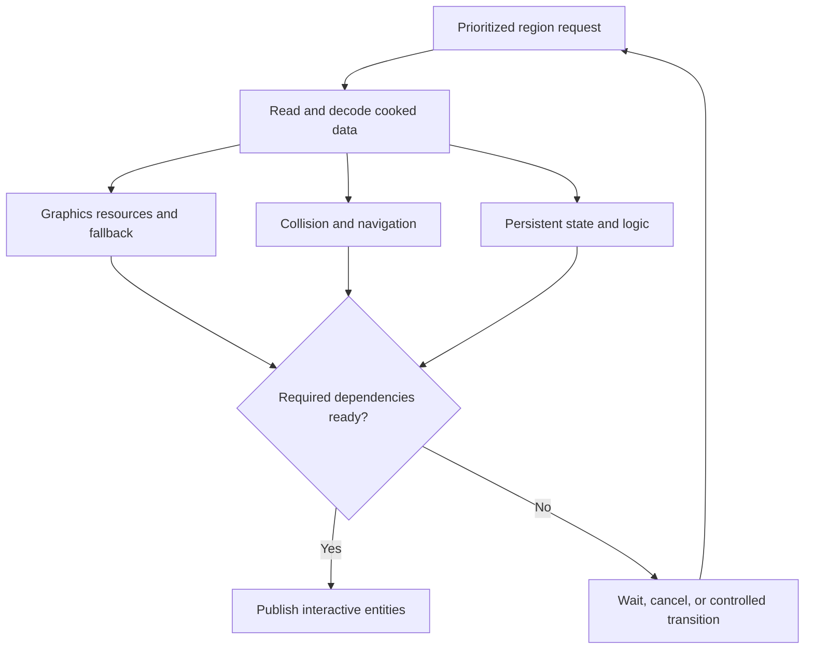

# Building an independent open-world engine inspired by RAGE

Public-source research and engineering blueprint · 23 November 2026

Prepared from 63 completed AI research and critical-review assignments. All proposed workloads, budgets, staffing scenarios and schedules require implementation and validation.

## Research method and evidence labels

This project used 63 distinct AI researcher/reviewer assignments, with at most three research agents running concurrently alongside the coordinator. Each assignment checked public primary material, recorded sources and separated evidence from proposed design. The coordinator reconciled the findings, retrieved central sources directly and incorporated critical reviews of scope, integration, performance and evidence. The assignment register below records the resulting decisions.

Coverage included official Rockstar disclosures; public GDC and SIGGRAPH material; original graphics and character-control research; engine and platform documentation; and author-maintained repositories. This is a broad, inspectable research program, not a claim to have searched the entire internet. It supplies a design and validation plan, not an implemented or benchmarked engine.

Three labels govern the report: **documented evidence** means a source explicitly supports the claim; **proposed design** means the report recommends an independent implementation; **planning assumption** means a number or scenario is an input to be tested. Material about Frostbite, Horizon, Unreal, Godot or other engines is attributed to that source and is not evidence of RAGE's internals. Patents, job descriptions and gameplay footage would not by themselves prove a particular algorithm shipped.

Some conference pages expose abstracts or synopses without the complete video or deck. Those limits remain explicit. Large or inaccessible linked files are listed only as further-reading targets with an access note. No leak, stolen source tree or confidential SDK is needed for the recommendations in this report. Public availability and reuse permission are different questions; repository licenses and content provenance remain part of dependency selection.

### Reading map

| Question | Sections to read |
| --- | --- |
| What must be built? | First product, scope levels, architecture contracts, streaming and capability inventory |
| What can be reused? | Project ownership, implementation stack, asset pipeline and platform boundaries |
| What makes the world convincing? | Living world, animation/physics, rendering, audio and representative content |
| How can the plan fail? | Performance, eight evidence gates and risk experiments |
| What people and sequence are needed? | Development sequence, first 90 days, people/time/funding |
| What did the 63 assignments contribute? | Appendix A and the linked reference catalog in Appendix B |

## Main conclusion

My engineering assessment is that public research is sufficient to design an original engine with the characteristics associated with Rockstar-style open worlds: continuous traversal, layered simulation, responsive physical interactions, coherent lighting and weather, authored missions, and persistent world changes. This research has not implemented or benchmarked that engine. The difficult work is making those systems share ownership, time, memory, and authoring workflows. Acquiring more rendering algorithms does not by itself solve that integration problem.

The proposed project is an independent engine with its own code and assets. Public descriptions of RAGE inform selected goals, but do not reveal its complete architecture. Other studios' technical publications provide additional implementation patterns; those must remain attributed to their actual engines.

## Evidence boundaries

- Rockstar's SIGGRAPH 2019 atmosphere abstract documents an integrated treatment of sky, clouds, fog, ambient lighting, scattering and transmittance, including shared use for reflections and sky irradiance. It supports a lesson about coherence, not a reconstruction of the entire renderer. [Source](https://advances.realtimerendering.com/s2019/index.htm)
- Rockstar's 2011 Max Payne 3 explanation distinguishes RAGE from a customized Euphoria behavior system. It is historical evidence, not a specification of current RAGE. The proposed independent design likewise needs behavior/control beyond a rigid-body solver. [Source](https://www.rockstargames.com/newswire/article/ak14o88381o725/asked-answered-max-payne-3-la-noire-red-dead-and-more.html)
- The public GDC horse-session synopsis establishes the subject and selected design goals; the complete presentation was not inspected. The complete internal animation architecture, streaming scheduler, population limits, current renderer, and development costs remain unverified. [Session synopsis](https://gdcvault.com/play/1027113/AI-Summit-Making-the-Believable)

## Proposed first product

Use a native PC, single-player, third-person urban district as the first integration target. Fix an actual reference machine, operating system, graphics driver, resolution, scene and quality settings before accepting performance claims. An initial 1 km² district can contain a road loop, a dense street, an open vista, two accessible interiors, one character rig, two vehicle types, a small mission, time of day, rain, and persistent changes. Geographic area is only one dimension: density, speed, visibility, unique asset turnover, active interactions and authoring complexity determine the load.

Candidate scene targets are 50 visible pedestrians, 20 traffic vehicles, and a deliberately smaller pool of fully simulated nearby actors. These are workload proposals to test, not promises. Expand them only after measuring expensive animation, physics, perception, pathfinding, draw submission and shadow work together. The first useful test is a player who drives through the district, turns abruptly, gets out, collides with an object, enters an interior, completes a mission, saves, travels away and returns to the correct changed state.

The urban district is a proposed integration test, not a requirement imposed by the RAGE name. A wilderness or horseback game would shift content and simulation effort toward terrain, vegetation, animal locomotion, water and long sightlines. Keep the same identity, readiness, persistence and authoring contracts while changing the representative workload.

### Three levels of scope

| Stage | Mandatory evidence | Deliberate limits |
| --- | --- | --- |
| Feasibility core | Edit, cook, stream, interact, evict, restore and package a small route; unique regional content exceeds a forced residency allowance | One platform/backend and one controllable character or vehicle; simple visuals and no requirement for NPCs |
| Playable district | The integrated district workload, useful authoring tools, bounded population, coherent presentation and persistent mission state | Limited interiors, vehicle/character variety and authored interactions; measured quality settings |
| Later specialization | A separately justified workload and tests for each new capability | Large maps, advanced physical reactions, broad destruction, networked operation, browser and console editions are separately scoped projects |

Adopt a library only when the current playable test needs it. A vehicle-only feasibility prototype can defer skeletal animation and pedestrian navigation. Start with clear data structures and an adequate scheduler; a universal reflection system, custom ECS framework, fiber runtime or elaborate render-graph compiler is not a prerequisite for the first test.

## Choose what the project owns

For this request, the recommended route is an original runtime assembled around selected libraries. Own the world model, readiness and residency policy, simulation tiers, interaction contracts, tools and game integration. Reusing a collision solver or compression library does not prevent that runtime from being an independent engine. It does mean the dependency's behavior, upgrade path and integration tests become part of the project.

If the commercial objective becomes shipping a game, evaluate an existing engine against the same district before funding a custom runtime. Epic documents both World Partition and licensed C++ source access; Godot documents extension modules and GDExtension. These are different starting points, not evidence that either meets this project's workload without testing. Unreal source access is governed by its terms and should not be described as an unrestricted source pool for a competing engine. [Unreal source access](https://www.unrealengine.com/ue-on-github) · [Godot extension mechanisms](https://godotengine.org/features/)

| Route | Main benefit | Main work retained |
| --- | --- | --- |
| Original runtime plus libraries | Full control of the engine's world, simulation and content contracts | Integration, renderer, authoring tools, pipelines, reliability and ongoing maintenance |
| Extend an existing engine | Existing editor, content path and many integrated mechanisms | Project-specific simulation, traffic, missions, persistence, assets and performance qualification |
| Research prototype in an existing engine, then custom runtime | A fast way to study desired behavior and define a reference scene | Two implementations; the prototype's code and assets may have reuse restrictions |

Choose deliberately. A fork is a legitimate engineering project, but should be identified as a fork. A custom renderer alone is not the full independent open-world engine described here.

## A practical initial implementation stack

The following is a proposed shortlist, not a tested compatible distribution. Pin exact revisions and review their license files, optional dependencies and sample assets before adoption. Avoid exposing vendor-specific types throughout game code; use narrow adapters where replacement is plausible.

| Responsibility | Initial candidate | What the project still supplies |
| --- | --- | --- |
| Runtime language and build | C++20, a pinned compiler and reproducible build configuration | Ownership discipline, allocation policy, debugging and build portability |
| Windows, input and platform events | SDL3 | Action mapping, focus rules, settings and platform policy |
| Graphics | One Vulkan or Direct3D 12 backend; SDL GPU is a narrower portability alternative | Renderer architecture, materials, lighting, resource lifetimes and asset readiness |
| Physics | Jolt | Collision cooking, layer rules, streaming integration, controllers and handling tuning |
| Navigation | Recast/Detour | World route hierarchy, lane rules, reservations, behaviors and dynamic blockage policy |
| Skeletal animation | ozz-animation, with a separately chosen compression path if necessary | Motion assets, retargeting, controllers, contacts, interactions and physical reactions |
| Mesh preparation | meshoptimizer | Quality/error policy, materials, LOD selection and runtime streaming |
| Developer interface | Dear ImGui | Full editor workflows, undo, data model and separate player-facing UI |
| Diagnostics | Tracy and RenderDoc | Repeatable scenes, annotations, regression gates and performance interpretation |
| Network transport, only for a networked product | GameNetworkingSockets | Authority, replication, prediction, identity and services |

C++ is an engineering preference for this proposed native stack and its library interfaces, not a claim that a language guarantees performance or that every RAGE subsystem uses it. An experienced team can choose another systems language, but must account for interoperation, debugging, tooling and platform support. Select one ownership and error-handling policy before mixing runtime languages.

SDL GPU provides graphics/compute and backend selection but still needs appropriate shader formats. Portability abstractions should describe actual capabilities, synchronization and memory behavior; they should not promise that every backend exposes the same feature set. [SDL GPU](https://wiki.libsdl.org/SDL3/CategoryGPU)

The inspected main-project licenses are **zlib** for [SDL](https://github.com/libsdl-org/SDL/blob/main/LICENSE.txt) and [Recast](https://github.com/recastnavigation/recastnavigation/blob/main/License.txt); **MIT** for [Jolt](https://github.com/jrouwe/JoltPhysics/blob/master/LICENSE), [ozz](https://github.com/guillaumeblanc/ozz-animation/blob/master/LICENSE.md), [meshoptimizer](https://github.com/zeux/meshoptimizer/blob/master/LICENSE.md), [Dear ImGui](https://github.com/ocornut/imgui/blob/master/LICENSE.txt) and [RenderDoc](https://github.com/baldurk/renderdoc/blob/v1.x/LICENSE.md); and **BSD-3-Clause** for [Tracy](https://github.com/wolfpld/tracy/blob/master/LICENSE) and [GameNetworkingSockets](https://github.com/ValveSoftware/GameNetworkingSockets/blob/master/LICENSE). These branch references identify the inspected main licenses; they are not an audit of every bundled dependency or asset. Archive the exact license texts and notices with the selected immutable revisions.

Public reference implementations such as Filament's material/lighting documentation are useful learning resources. Adopt code only under its applicable license; a paper, a code repository and the images or models shipped beside it can have different reuse conditions. Public visibility alone does not establish permission to redistribute.

## Architecture contracts

### Identity and ownership

Represent an object in three forms: an editable authoring record, a persistent world record, and an optional resident runtime entity. Persistent identity survives streaming and saves; a runtime slot plus generation detects stale references. Do not serialize raw pointers or assume a loaded entity index is its permanent identity. Flecs documents generation-based recycled-entity detection; separating that mechanism from persistent identity is this design's recommendation. [Source](https://www.flecs.dev/flecs/EntitiesComponents.html)

Each authoritative property has one writer in a given simulation phase. A vehicle's physics transform, character controller position, animation root, mission objective, and renderer snapshot need explicit ownership and handoff. Use component arrays or specialized pools for hot data; keep editor representation convenient for authoring. A scene tree, ECS library, or message bus does not decide persistence or thread safety on its own.

Define safe publication phases for entity creation/removal, activation, ownership changes and save capture. Jobs can prepare results concurrently, then validate their versions immediately before commit. Resolve conflicting commands, such as damage and possession, in a declared order. Disjoint work may remain parallel; this policy does not imply a global lock around every frame.

Keep stable asset identity, cooked-product revision/hash and persistent-world baseline version distinct. A mesh rebuild should not create a new person or restore a destroyed door. Conversely, preserving an ID cannot make incompatible skeleton or collision data valid. Editor undo modifies source state; applying runtime play-state changes back into source must be an explicit workflow.

### Time and execution

Use a fixed simulation step for critical physics and controllable gameplay, with render interpolation. Budget catch-up work so overload does not create unbounded additional work. Schedule jobs through explicit dependencies; prevent blocking file I/O from occupying every CPU worker. Record time spent queued, executing, waiting, and publishing. Total CPU work and elapsed critical-path time are different measurements. A parallel scheduler does not automatically yield deterministic simulation.

Separate monotonic elapsed time for deadlines/profiling, simulation ticks for authoritative updates and game-calendar time for schedules/weather. Specify their behavior during pause, slow motion, overload and loading. Distant activity should catch up through bounded events or summaries, not by replaying hours of full simulation when an actor becomes visible.

### Coordinates

Specify world units, axes, handedness, gravity, and coordinate conversion at the asset boundary. Choose local float simulation, sector coordinates, global double positions, or a combination based on measured precision requirements. A small district does not demand a planet-scale coordinate system. If origin shifting is used, it must update physics, particles, audio, animation contact targets, AI paths, cameras and temporal histories consistently; asynchronous results must carry the coordinate epoch used to compute them. [Precision tradeoffs](https://docs.godotengine.org/en/stable/tutorials/physics/large_world_coordinates.html)

## Streaming is a readiness system

A region progresses through request, read, decompression, decoding, dependency resolution, resource residency and safe activation. Graphics, collision, navigation, audio and mission data may have separate schedules and different spatial partitions. Only publish an interactive object when its required dependencies are ready. A building facade can use a distant proxy while its interior remains unloaded. A mission-critical actor may need resident logic outside the visible area.

The Horizon Forbidden West physics presentation documents an encounter-level collision guarantee and the importance of avoiding costly insertion locks. This is an example from Guerrilla, not evidence of RAGE internals. It motivates a proposed invariant: an active character must never rely on collision that the streaming system is allowed to evict. [Source](https://jrouwe.nl/architectingjolt/ArchitectingJoltPhysics_Rouwe_Jorrit_Notes.pdf)

Use an explicit admission controller: reserve memory for in-flight reads and decompression; limit activation work per frame; favor collision and essential interaction data over optional visual refinement; expose why a request is pending. Cancellation suppresses obsolete publication but does not mean an outstanding GPU or I/O operation has stopped using its buffers. Retire resources only after all consumers finish. [GPU retirement](https://learn.microsoft.com/en-us/windows/win32/direct3d12/fence-based-resource-management)

For planning, additional directional prefetch distance is approximately maximum travel speed multiplied by measured end-to-end tail readiness latency, plus margin. If a future prototype measures a two-second tail latency and uses an assumed maximum speed of 60 m/s, that term would be 120 m. No such measurement has been performed in this research. Include visible/interaction extent separately; test reversals, camera cuts and teleports. Teleports need destination preparation or a designed loading transition.

Validate a completion's request generation, region generation, content/dependency revision and coordinate epoch at publication. An old request may finish successfully after its intended destination has changed; success at the I/O layer is insufficient. Collision and navigation readiness must refer to compatible content revisions. Give every residency pin an accountable owner, reason and release path. Inspect dependency fan-out: one seemingly local object must not silently pull most of the map into memory.

Reserve peak overlapping memory before transitions. If keeping the source region alive while loading the destination cannot fit, a policy that waits forever for both is defective. Provide a deliberate loading transition, temporary safe staging state or a smaller admissible destination set. Optional visual refinement can be delayed; mandatory collision cannot disappear underneath an active actor.

The gate is object-specific: distant scenery, a playable road and a mission character have different mandatory dependencies. This is a proposed readiness contract; it does not require every resource to share one file, grid or update rate.

Storage throughput, decompression throughput, GPU upload capacity and entity activation rate are separate limits. DirectStorage is one optional platform-specific part of that path; its documentation describes out-of-order completion, bounded queues, independently compressed sections and staging-memory costs. It does not construct the engine's world state. [Source](https://github.com/microsoft/DirectStorage/blob/main/Docs/DeveloperGuidance.md)

## A living world with bounded simulation

Use independent significance decisions for rendering, animation, physics, AI and networking. A mission target behind the camera can need accurate simulation while a visible distant pedestrian can use a cheap representation. Full fidelity should follow meaningful interaction, not merely distance.

Suggested tiers: nearby interactive actors receive detailed controllers and collision; middle-distance actors use simplified routes, lower-rate decisions and reduced animation; distant persistent actors retain identity, schedule and significant state; purely decorative population can be regenerated under a defined policy. Promotion between tiers must preserve continuity. Returning to an area should not duplicate a person, resurrect a destroyed object or forget a mission result.

Treat promotion and demotion as state transfers. Prepare the destination representation, settle or transfer interaction leases, then commit authority once. On failure, retain the previous valid state or enter an explicit unavailable state. Several representations may coexist briefly, but a distant schedule and resident controller must never independently advance the same authoritative actor. Supporting surfaces, occupants and mission commitments constrain which fidelity changes are valid.

Navigation needs tiled walkable geometry, a coarse route graph, local avoidance and smart links for doors, stairs and vehicle interactions. Traffic also needs lane topology, intersection rules, following, yielding and recovery from blockage. NPC behavior needs perception budgets, interpretable state, reactions and priority rules. Mission actors should acquire explicit, bounded reservations instead of silently competing with ambient population logic.

## Animation, physics and interaction

Build a skeletal import and compression pipeline, a character controller, locomotion transitions, foot placement, contact alignment, interactions and controlled ragdoll transitions. Evaluate motion matching only after acquiring a representative motion dataset. Ubisoft's public explanation makes the data dependency explicit: matching selects available motion; it does not automatically invent every combination of actions. [Source](https://www.ubisoft.com/en-us/studio/laforge/news/6xXL85Q3bF2vEj76xmnmIu/introducing-learned-motion-matching)

Physical animation adds joint targets, motors, balance strategies, impact reactions and recovery policies on top of collision and constraint solving. Treat a convincing limited behavior, such as bracing and recovering from a shove, as a research milestone. Do not promise a complete Euphoria substitute because a ragdoll sample runs.

For the first milestone, narrow this further to driven joints, a controlled fall and an authored get-up; robust active balance can follow as a separate investigation. Route root motion through one collision-aware movement owner. Before restoring a standing controller, verify support and capsule clearance and define collision handoff. A moving platform or obstructed get-up space must have a valid fallback.

For vehicles, begin with a well-tested rigid-body library and a bounded wheel/suspension model. Driving quality also depends on tire response, gearing, steering, center of mass, assistance, camera behavior, sound, collision geometry and tuning. Decorative traffic can use cheaper models than the player vehicle; transitions between models are part of the design. Deformation, full structural destruction and soft-body vehicles are separate optional projects.

Make entry and exit interruptible interactions: reserve a seat, validate the vehicle and approach, align animation, commit attachment/control, and clean up on failure. Define what happens if the vehicle moves, is destroyed, streams away, or becomes mission-owned mid-transition. Preserve occupants, pose, velocity and authority through simulation LOD changes.

## Rendering and coherent presentation

Start with one graphics backend, a reliable material model, direct lights and shadows, image-based lighting, texture/mesh LOD, a stable exposure pipeline and visible GPU timings. A render graph describes pass/resource dependencies and helps manage lifetimes; it does not remove the need for synchronization correctness. [Frostbite precedent](https://www.gdcvault.com/play/1024612/FrameGraph-Extensible-Rendering-Architecture-in)

Add instancing and visibility reduction early. Introduce GPU-driven culling and indirect drawing when the measured CPU cost supports it. Test moving occluders, fast camera changes, foliage and shadow cameras. Advanced virtual geometry, general dynamic ray-traced GI and additional graphics backends should earn their maintenance cost.

Materials, exposure and lighting require a consistent convention. Validate texture color spaces, tangent bases, roughness, normal maps and scales. Use scene-linear lighting and a defined display transform; an HDR buffer alone is not an HDR display pipeline. Filament's published material and imaging reference is useful for implementation and validation. [Source](https://google.github.io/filament/main/filament.html)

Weather must drive shared state across clouds, fog, sun visibility, wind, surface wetness, reflections, particles, audio and relevant gameplay. Dynamic daytime lighting needs an explicit indirect-light strategy: a bright daytime bake cannot simply be left unchanged at night. Start with a bounded solution and document where probes, baked data, screen-space methods or dynamic updates fail.

Photorealism also requires authored geometry, calibrated surfaces, convincing motion, scene composition, sound and stable temporal output. No collection of shader names establishes that quality. Use fixed lighting tests and representative motion sequences, then inspect difficult transitions rather than only still images.

Test temporal histories after camera cuts, origin shifts, LOD changes, disocclusion and resolution changes; invalid history produces visible errors even when the individual frame looks correct. Specify acceptable indirect-light convergence after time changes, destruction and teleports. Account separately for shadow updates, foliage, layered transparency and skinned characters. GPU memory budgets must include persistent lighting/visibility caches and temporal histories as well as the current frame's transient buffers. Epic's Lumen documentation is a useful example of openly documented update and representation limitations, not a required implementation for this engine. [Lumen technical details](https://dev.epicgames.com/documentation/en-us/unreal-engine/lumen-technical-details-in-unreal-engine)

## Asset production and editor

The editor and build pipeline are primary deliverables. Designers need selection, transforms, undo/redo, prefabs, property inspection, world-region loading, asset search, mission editing and reproducible play sessions. Specialists need overlays for collision, navigation, streaming, animation contacts, AI decisions, entity identity, resource residency and frame timing. Every difficult subsystem should explain why it made a decision.

Create a headless asset cooker alongside the first runtime. Editable sources are inputs; cooked meshes, textures, collision, animation, navigation and audio are versioned products. A cache key must reflect the source, importer version, settings, platform and relevant dependencies. Build failures must preserve the last valid asset. A clean build and incremental build should produce equivalent usable content. O3DE's asset processing documentation provides a public example of scheduling builders, tracking dependencies and notifying runtimes of updated products. [Source](https://docs.o3de.org/docs/user-guide/assets/asset-processor/)

Use a small, explicitly supported interchange subset initially. Define meters, axes, mesh winding, tangent conventions, skeleton rules, material semantics and collision tags. Do not assume a standard file format preserves every DCC feature. Generated roads must produce compatible render, collision, lane, pedestrian and placement data. Procedural generation needs stable seeds, editable overrides and provenance; otherwise a harmless regeneration can destroy authored work or invalidate saves.

For collaboration, avoid placing the entire world in one constantly conflicting file. Keep human-reviewable source records separate from optimized runtime packages. Provide asset ownership, reference validation, change previews and source-control integration. Bulk binary changes need an intentional storage strategy. Shared derived-data caches should be disposable accelerators; the canonical source and tool versions must be sufficient to rebuild.

Start collaboration with versioned source records, retained binary assets and one clean validation worker. File boundaries for editing need not match runtime streaming chunks. Validate related changes together, preserve stable IDs, and record schema/tool compatibility across branches. Add build workers and shared caches when measured iteration queues justify them; preserve the source, build manifest and symbols even when cache data is discarded.

Before expanding the map, create a representative asset kit: one production-style rig and motion set if characters are in scope, modular street/interior pieces, a few interaction props, vegetation, one vehicle, calibrated materials and synchronized sounds. Have an artist independently import, inspect, revise and package it. Evaluate movement/contact errors and LOD changes under multiple lighting and weather conditions, alongside memory and frame costs.

## Missions and persistence

Use a game layer above engine mechanisms. The engine supplies clocks, entities, interactions, queries, serialization and scheduling; the game defines crimes, factions, objectives, weapons, inventories and story rules. Mission logic needs explicit states, interruption and cleanup, stable object references and an editor-visible execution trace. A mission requesting a vehicle should not assume that a particular in-memory pointer remains valid after streaming.

Saves should record world changes against a known baseline, with content/schema versions, persistent IDs, meaningful timestamps and recoverable write semantics. Runtime caches are reconstructed. Define persistence policy by object category: an important NPC, a destroyed bridge, a dropped object and decorative litter need not have identical retention. Test saving during transitions, migrating old saves, interrupted writes and returning to unloaded locations.

For concurrent changes, use defined ownership or transactional commands. Examples include an ambient traffic vehicle becoming mission-owned, a door being destroyed during a scripted opening, or an actor dying while its region unloads. Capture a consistent checkpoint and make retryable events idempotent. These are proposed engineering contracts; none is asserted to be Rockstar's implementation.

Keep an engine-owned ledger for mission reservations and streaming leases. Validate instance, generation and expected state before a delayed callback changes the world. Store mission completion and its reward transaction identity together so a retried callback cannot grant the reward twice. Async saves need immutable snapshots and ordered publication: an older slow write must not replace a newer save. Version mission meaning and referenced content as well as serialized field layouts. SQLite's atomic-commit documentation illustrates why durability depends on an actual storage protocol and assumptions; a rename alone is not a universal power-loss guarantee. [SQLite commit design](https://www.sqlite.org/atomiccommit.html)

### Scripts and optional mods

Start with internal scripts through a versioned, bounded game API. Scripts should issue validated commands against generation-checked handles, not retain arbitrary engine pointers. Limit memory, queued work and execution time; expensive native callbacks need their own budgets. Reload only at defined safe points with callback invalidation, resource cleanup and explicit state migration.

If downloaded mods are later required, define a separate trust boundary: restricted file/network capabilities, structural and semantic asset validation, resource quotas and an explicit extension API. Selecting Lua or WebAssembly alone does not establish the safety of host functions exposed to scripts. Treat a public mod platform and distribution services as additional product scope. [Lua reference](https://www.lua.org/manual/5.4/manual.html) · [Wasmtime security model](https://docs.wasmtime.dev/security.html)

## Multiplayer, when required

Decide before core gameplay whether the target is single-player, small co-op, competitive sessions or a persistent online world. Those have different consistency and operational needs. A single-player-first milestone is a scope choice, not a claim that multiplayer can be added cheaply later. Epic's public networking overview explains why retrospective networking can require substantial gameplay restructuring. [Source](https://dev.epicgames.com/documentation/en-us/unreal-engine/networking-overview-for-unreal-engine)

For a networked target, define authoritative state, entity ownership, interest regions, snapshot and input protocols, prediction/reconciliation, relevant physics policy, reconnect behavior and server-side validation. Assets may be locally installed while state is replicated; rendering a world and knowing its authoritative state are different responsibilities. Test actors and vehicles crossing relevance boundaries under loss, delay and out-of-order delivery.

Specify network behavior by object class. Local player control may need prediction and correction; remote agents may use interpolation; important collisions need an authority policy; decorative debris may stay cosmetic. If multiplayer is a product requirement, put a two-client test for vehicle possession, damage and region transitions in the early architecture phase. Do not defer that experiment until the district is polished. Define separate service and operational requirements for sessions, identity, deployment, diagnostics, abuse handling and ongoing support.

Valve's GameNetworkingSockets is a public transport candidate with reliable and unreliable messages. Its own documentation explicitly excludes higher-level entity serialization and delta encoding. A transport library therefore does not supply an open-world replication system, accounts, moderation, matchmaking or operations. [Source](https://github.com/ValveSoftware/GameNetworkingSockets)

## Audio and player-facing systems

Budget audio voices and streaming alongside graphics. The first audio layer needs spatial sources, distance behavior, buses, priorities, surface-dependent events, vehicle layers, room transitions and a dialogue/music state machine. An audio callback must not wait for asset I/O or main-thread locks. Add acoustic propagation where it improves gameplay and can be measured; Steam Audio provides public support for spatialization, occlusion, reflections and baked propagation. [Source](https://valvesoftware.github.io/steam-audio/)

Input mapping, controller reconnection, remapping, camera collision, pause behavior, UI scaling, subtitles, text shaping and localization are core usability requirements. Accessibility options and resource budgets should survive saves and platform changes. Cinematics must share world identity, streaming preparation, animation and audio timing; skipping or interrupting a cinematic must leave valid gameplay state.

## Performance and acceptance

The following are proposed planning constraints, not benchmark results or claims about Rockstar. For a 60 Hz target, one refresh interval is 16.67 ms. Measure CPU critical-path time and GPU frame time separately: they can overlap, so adding all worker durations to GPU time gives the wrong throughput estimate. Queuing can also increase latency while average frame rate remains acceptable.

An initial reference profile could use an explicitly identified eight-core desktop CPU, 32 GiB of RAM, a discrete GPU with 12 GiB of VRAM, an NVMe SSD and 1080p output. The actual CPU/GPU models and supported feature set must be fixed before this becomes an acceptance specification. These capacities do not establish performance. Set measured working-set caps with headroom for drivers, operating-system use and transient allocations; track resident, reserved, decompression, upload and retirement memory separately.

### Required test routes

| Scenario | Required evidence |
| --- | --- |
| Cold launch into a district | Time to controllable play; source and cache state; peak memory; complete collision |
| Repeated high-speed traversal | Frame-time distributions, streaming queue delay, memory high-water marks and no persistent growth |
| Abrupt reversal or camera cut | Valid visibility; no stale requests publishing; acceptable visual refinement |
| Teleport to an unloaded region | Explicit readiness gate or loading transition; no missing ground or duplicate actors |
| Player takes a traffic vehicle | Single transform authority; continuous pose/velocity/occupants; no duplicate entity |
| Impact, destruction and path blockage | Stable physics, updated navigation/behavior and persistent significant changes |
| Save during transition, then reload | Consistent mission/world state; valid references; safe failed-write recovery |
| Content hot reload | No partial asset publication or invalid GPU use; clear error diagnostics |
| Night, rain and interior transition | Consistent lighting, reflections, fog, wetness and sound |
| Packaged build on a second machine | No dependency on editor caches or undeclared developer files |

Report p50, p95, p99 and worst frame intervals, counts above 16.67 ms and 33.3 ms, longest consecutive misses and route position. Keep individual runs instead of hiding a poor run in pooled results. A percentile threshold does not establish that every frame meets its deadline. A 60 Hz release target needs a separately agreed missed-frame and latency policy; this blueprint does not claim it has been achieved.

Define cold precisely: engine residency, the operating system's file cache, derived assets and driver/PSO caches are different. Restarting the executable does not clear them all. Report startup, first traversal and warmed loops separately. Keep instrumentation overhead, loading screens and ordinary gameplay distinct. Rendering experiments can use fixed-frame replays, but streaming acceptance must maintain the intended wall-clock travel speed and concurrent gameplay load; a slow simulation can accidentally give storage extra time. Record the actual CPU/GPU, driver, power settings, content/build hashes and presentation mode. [Benchmark methodology](https://gpuopen.com/learn/unreal-engine-performance-guide/)

Use automated headless tests for state and content, integration routes for subsystem contracts, and visual/motion review for quality. Replays require a defined reproducibility scope. Input recording alone is not proof of cross-platform deterministic physics; retain build/content versions, seeds, important asynchronous events and periodic state checkpoints. Test stale completions, delayed storage, dropped network messages where relevant, shader cache misses, allocation pressure and malformed assets.

### Eight gates before expanding scope

1. **Reproduce the package:** a second machine builds and launches from retained inputs with declared tool, content and configuration versions.
2. **Prove eviction:** unique regional working sets exceed a deliberately reduced residency allowance; traces demonstrate actual eviction and reload, not just repeated geometry remaining resident.
3. **Meet readiness deadlines:** prescribed wall-clock travel, reversal and destination preparation preserve required collision and compatible state, or enter a declared controlled loading transition.
4. **Bound peak memory:** resident, in-flight, transient and retiring allocations stay within declared CPU/GPU caps and stabilize during repeated traversal. An initial proposed 30-minute soak is a test, not proof of indefinite stability.
5. **Report the frame contract:** retain each run's CPU, GPU and presentation measurements, tail timings and missed-frame counts; pass thresholds are agreed before tuning and remain unvalidated until tested.
6. **Survive asynchronous failure:** delayed/canceled work, changed content, origin shifts and GPU delays cannot publish stale state, invalidate live buffers, leak pins or deadlock transitions.
7. **Restore persistent state:** mutations, ownership and reward identities survive unload/save/restart; interrupted writes recover a valid committed generation. Process interruption and power-loss durability are different tests.
8. **Enable independent authoring:** another contributor imports, edits, diagnoses an invalid asset, cooks and packages the scene without engine-code changes.

Every gate needs an owner and retained evidence such as a build manifest, trace, save fixture or recorded workflow. If a gate fails, narrow content or feature scope and repair the underlying contract before increasing world size or population. Exact hardware, visual quality, content throughput and staffing remain decisions to validate through these experiments.

## Development sequence

Treat phases as gates. Calendar ranges are provisional planning envelopes and should be revised after the first measured integration prototype.

1. **Specification and foundation:** Define the reference workload, units, ownership, IDs, platform, clocks and budgets. Build the executable, headless harness, profiler and minimal asset format.
2. **Streaming skeleton:** Cook and stream a blockout district with collision and diagnostics. Drive a fast camera through it under constrained memory. Prove cancellation, load failure and retirement.
3. **Controllable interaction:** Add an instrumented movement controller, then a vehicle, basic camera and interaction ownership. Establish a small reusable test course before investing in polish.
4. **Living district:** Add authored roads, limited crowds/traffic, schedules, navigation, one mission and persistent world deltas. Validate complete gameplay loops.
5. **Coherent presentation:** Improve materials, shadows, atmosphere, animation contacts, audio, terrain and content. Add advanced rendering only against a measured need.
6. **Production hardening:** Strengthen independent authoring workflows, clean builds, migration tests, crash diagnostics, scalability settings and target-platform qualification. A networked product must already have exercised authority and replication in the early phases.

### Proposed first 90 days

This is a time-boxed feasibility experiment for an experienced small team using existing libraries and blockout or licensed assets. It is not a promise of a finished engine. The full district described earlier is a subsequent integration target; population, weather and a second vehicle are stretch work during these 90 days.

| Period | Deliverable | Decision gate |
| --- | --- | --- |
| Days 1–14 | Written scope; reference machine; build, input, profiler, IDs, one imported object and clean packaging | Can another developer reproduce the build and edit the test content? |
| Days 15–35 | Asset cooker, cell loading, static collision, bounded queues, simple editor and persistent-state fixture | Can a changed object survive unload/reload without missing collision or unbounded memory? |
| Days 36–60 | One controllable character or vehicle, a basic camera and interaction handoff; save/restore fixture | Are control, collision, identity and transform ownership stable at boundaries? |
| Days 61–75 | Repeatable streamed route, interruption and unload/reload cases, one persistent world change | Does the same state survive travel and reload with bounded memory? |
| Days 76–90 | Packaged feasibility prototype, performance traces and independent content edits | Is the next investment justified by measured bottlenecks and authoring throughput? |

The 90-day output should answer whether the architecture works and which assumption is expensive. A polished district follows only after those answers; a large map is not an automatic next milestone.

The table describes acceptance order, not isolated departmental handoffs. Runtime/streaming, cooker/editor/build and interaction/persistence tracks should overlap from the beginning. Repeat independent editing and clean packaging throughout; do not postpone them until the final week.

## People, time and funding

These are hypothetical planning scenarios, not measured industry minimums, salary quotes, Rockstar staffing claims or promises of completion.

A focused prototype could allocate four to six experienced contributors, for example three runtime/graphics/gameplay engineers, one tools engineer, one technical artist and one designer responsible for test scenarios. That arrangement assumes reused low-level libraries, limited content and one platform. It cannot simultaneously sustain broad renderer research, realistic characters, sophisticated traffic, multiplayer and production-quality art.

A sustained twelve-person core could allocate one technical lead/runtime engineer, two rendering engineers, two world/streaming engineers, two physics/animation engineers, one AI/gameplay engineer, two tools/pipeline engineers, one build/automation engineer and one technical artist. This is a way to expose responsibilities, not an optimal staffing formula. It needs additional or shared design, environment and character art, animation, audio, production, QA and platform expertise. Online services, advanced UI and console editions require explicit allocation rather than assumed spare capacity.

The essential skills include systems programming, numerical reasoning, concurrent scheduling, real-time graphics, physics/controller integration, animation, navigation, data pipelines, editor design and performance diagnosis. A small team can combine roles, but every subsystem boundary still needs an accountable owner. Budget recurring integration, documentation and maintenance time.

Headcount represents available capacity, not twelve productive hires arriving immediately. Model hiring ramp, onboarding, leave, review and integration explicitly. Keep engine development, content production and ongoing online operations as separate cost categories when they are in scope.

For transparent arithmetic only, assume USD 180,000 per average full-time person-year of loaded personnel expense. Six people for a quarter-year imply USD 270,000; twelve people for two years imply USD 4.32 million. The input rate is an assumption, not a researched market rate. Neither calculation forecasts a completed engine. Define what loaded expense includes, then separately account for content staff, outsourcing, external QA, hardware/build infrastructure, commercial licenses, recruiting, operations and contingency without counting the same overhead twice.

A solo developer can pursue a narrow research engine and progressively demonstrate individual systems. Broad production reliability and high-volume content require a different plan. Re-estimate after each measured gate, using actual integration effort and designer iteration time. Public sources do not provide a credible universal schedule for matching Rockstar's breadth.

## Platforms and the public-knowledge boundary

Start on one native desktop platform and one graphics backend. Keep platform services behind explicit interfaces for files, input, windows, users, networking and lifecycle events. Add another backend or operating system when a real target and test matrix justify it.

A WebAssembly/WebGPU target can reuse selected logic and content concepts, but needs its own delivery and memory budgets, asynchronous loading, persistence completion and graphics capability checks. Emscripten documents browser threading requirements and the need for separate threaded and non-threaded builds; compiling C++ to WebAssembly does not by itself provide native scheduling or storage behavior. [Emscripten pthreads](https://emscripten.org/docs/porting/pthreads.html)

Console ports require authorized platform access and release work beyond this public research. Sony describes approved registration and the GDPA before access to its development resources; Nintendo documents agreements, a separate Switch-information application and publication review; Microsoft separates registration, GDK agreements and certification. These public pages establish access boundaries, not a console implementation specification. A strictly public-only blueprint cannot supply gated SDKs or validate a commercial console build. [Sony](https://sonyinteractive.com/en/news/blog/showing-your-game-to-playstation/) · [Nintendo](https://developer.nintendo.com/the-process) · [Microsoft](https://learn.microsoft.com/en-ca/gaming/game-publishing/publishing-processes/managed-creators/overview)

## Risk register and early experiments

| Risk | Early experiment | Design response if it fails |
| --- | --- | --- |
| Streaming throughput or activation spikes | Repeat a fast route with delayed I/O and a reduced residency cap | Reduce unique data turnover, change chunking, move preparation off critical threads, constrain activation |
| References destroy locality or transition headroom | Inspect dependency fan-out and teleport while the source region is pinned | Remove accidental hard dependencies; add an explicit loading fallback instead of waiting for impossible residency |
| Global locks prevent scaling | Trace concurrent collision queries, insertion and AI/animation jobs | Change ownership and batch boundaries; reduce contention before adding workers |
| Simulation LOD breaks identity | Repeatedly promote, possess, move, damage and demote the same actor | Introduce explicit handoff state and persistent records; eliminate independent copies of authority |
| Characters look convincing only in isolation | Evaluate locomotion, slopes, impacts, prop use and crowd motion together | Improve motion coverage/contact policy; narrow behavior scope before adding models |
| Visual features exceed GPU or memory budget | Compare fixed scenes with features toggled and capture outliers | Lower update rates, resolution or feature scope; preserve coherent fallbacks |
| Editor throughput is too low | Have a designer add and revise an encounter unaided | Improve inspection, asset validation, undo and iteration before expanding content |
| Save data becomes inconsistent | Inject interruption during transitions and writes; migrate old fixtures | Snapshot immutable state, version schemas and formalize ownership and recovery |
| A dependency changes or becomes difficult to maintain | Build a pinned clean release and document the wrapper boundary | Limit exposed vendor types; keep replacement and update paths explicit |
| Online scope expands late | Prototype two clients contending for one vehicle under bad networking | Rework authority early or keep the product explicitly single-player |

Keep a short architectural decision record for each significant choice: goal, alternatives, measured workload, selected approach, known limitations, and the trigger for reconsideration. New algorithms should answer a demonstrated problem. Conversely, an early shortcut that blocks streaming, identity or content iteration should not be protected merely because it was quick to write.

## Capability inventory

| Area | Engine responsibility | Content or production responsibility |
| --- | --- | --- |
| Core runtime | Tasks, clocks, memory, identity, errors and resource lifetime | Target platform and measurable workload |
| World | Partitioning, streaming, coordinates, queries and persistent state | Geography, density, traversal and encounter design |
| Graphics | Materials, lighting, visibility, temporal processing and quality tiers | Geometry, textures, calibrated surfaces and lighting direction |
| Characters | Skeletal playback, controllers, contacts, reactions and representation changes | Rigs, motion coverage, retargeting, acting and cleanup |
| Physics and vehicles | Collision, constraints, controller integration and tuneable models | Collision meshes, handling targets and interactive damage design |
| AI and traffic | Perception, execution, navigation, resource reservations and budgets | Routines, road rules, scenarios and behavior authoring |
| Gameplay | Safe scripting, state transitions, events and save contracts | Missions, mechanics, progression and narrative |
| Audio | Mixing, streaming, spatialization, timing and state transitions | Recordings, synthesis, sound design, dialogue and music |
| Tools | Import, edit, inspect, validate, cook, build and package | Asset governance, review, collaboration and iteration practices |
| Reliability | Tests, traces, diagnostics, migration and release qualification | Coverage priorities, hardware lab and sustained QA |

The content column does not disappear when engine code is generated quickly. A successful project funds both columns and checks their interaction through playable scenarios.

## Appendix A — All 63 research and review assignments

Each line records the coordinator's synthesis of a completed research or review assignment. Recommendations describe the proposed independent engine unless explicitly identified as source facts.

| # | Topic | Decision carried into the blueprint | Reference IDs |
| --- | --- | --- | --- |
| 01 | Public RAGE evidence | Preserve the date and scope of Rockstar disclosures; do not reconstruct undisclosed current internals from suggestive evidence. | S105, S147, S002, S063, S116 |
| 02 | RDR2 rendering evidence | Treat coherent atmosphere as a useful design goal; the inspected talk abstract does not specify the whole renderer. | S002, S005, S125, S129, S130, S090 |
| 03 | Animation and AI evidence | Separate documented horse/locomotion subjects from assumptions about proprietary animation architecture or Euphoria equivalence. | S147, S063, S116, S061 |
| 04 | First product | Use a representative district and named hardware; distinguish map size, visible population and expensive active simulation. | S015, S032, S141 |
| 05 | Build versus extend | Choose an original runtime for engine ownership; evaluate existing engines when the primary deliverable becomes a game. | S032, S151, S098, S043, S044 |
| 06 | Entity architecture | Separate persistent identity, resident generational handles and editable records; select data layouts by workload. | S137, S091, S047 |
| 07 | Jobs and concurrency | Express dependencies and safe publication; prevent blocking I/O from exhausting workers; fibers and work stealing are distinct choices. | S117, S073, S074 |
| 08 | Memory and lifetimes | Budget resident, pending, transient and retiring storage; retain buffers until every CPU, I/O and GPU consumer finishes. | S113, S066, S139 |
| 09 | Asynchronous streaming | Model readiness and activation explicitly; combine bounded queues, cancellation generations, priorities and measurable deadlines. | S141, S032, S082, S114 |
| 10 | Coordinates | Start with measured precision needs; coordinate shifts must cover all subsystems and invalidate stale asynchronous results. | S043, S016, S124 |
| 11 | Asset cooking | Version importer inputs and dependencies; preserve valid products after failures and reproduce clean builds. | S046, S045, S030 |
| 12 | Packaging and storage | Choose independent chunks and compression by observed access patterns; storage throughput is only one readiness limit. | S082, S081, S097 |
| 13 | Frame graph | Begin with a small pass/resource graph and explicit synchronization; expand infrastructure only when useful. | S142, S101, S051 |
| 14 | Geometry and visibility | Implement LOD, instancing and culling first; add GPU-driven submission against measured bottlenecks and transition tests. | S001, S095, S118 |
| 15 | Materials and color | Define units, texture color spaces, tangent conventions, exposure and display transforms consistently. | S100, S102, S040 |
| 16 | Lighting and GI | Pick a bounded indirect-light solution and test update convergence, thin geometry, interiors and moving objects. | S106, S006, S017 |
| 17 | Atmosphere and weather | Share weather state across lighting, fog, clouds, wind, wetness, reflections, audio and relevant gameplay. | S090, S145, S004 |
| 18 | Terrain, vegetation and water | Generate compatible rendering, collision and navigation; keep water appearance and physical queries consistent in space and time. | S039, S004, S041, S042 |
| 19 | Character rendering | Budget skin, eyes, hair, shadows and LOD together; polished assets and motion are essential inputs. | S011, S014, S003 |
| 20 | Motion and animation | Acquire representative motion coverage before motion matching; integrate compression, transitions, contacts and retargeting. | S150, S075, S083 |
| 21 | Physical animation | Use public control research as a starting point; a solver or ragdoll demo does not establish adaptive character behavior. | S078, S136, S153, S094 |
| 22 | Physics integration | Reuse a solver while owning collision cooking, activation, filtering, mutation phases and streaming readiness. | S077, S109, S123 |
| 23 | Vehicles | Include handling, tires, suspension, assists, camera and sound; preserve state when decorative traffic becomes interactive. | S078, S122 |
| 24 | Destruction | Start with authored breakables; destruction also changes collision, navigation, persistence and sometimes replication. | S121, S120, S034 |
| 25 | Navigation | Combine local navmesh queries, coarse routing, dynamic blockage and interaction links; paths must survive streaming changes. | S088, S127, S018 |
| 26 | Traffic and crowds | Model lanes, intersections, following, yielding and recovery separately from general pedestrian navigation. | S033, S053, S054 |
| 27 | NPC behavior | Use inspectable states, perception budgets, routines and explicit priorities; choose planning complexity by scenario. | S023, S029, S062 |
| 28 | Missions | Use stable references, explicit state transitions, reservations and cancellation cleanup outside transient script stacks. | S146, S023, S064 |
| 29 | Persistence | Save versioned world deltas and identities against a baseline; define recovery and migration before content grows. | S027, S149, S057 |
| 30 | Multiplayer architecture | Decide the online product early; authority, relevance and replication are separate from asset streaming. | S020, S025, S069 |
| 31 | Network prediction | Specify prediction, interpolation, correction and physics history by object class; validate loss and relevance transitions. | S060, S019, S059 |
| 32 | Editor and diagnostics | Make import, placement, inspection, mission tracing and packaging usable by contributors without engine-code edits. | S144, S021, S086 |
| 33 | DCC interchange | Support an explicit format subset; preserve provenance and stable identity independently of display names. | S128, S126, S068 |
| 34 | Audio | Budget voices and streaming; avoid blocking callbacks and coordinate spatial, vehicle, dialogue and music states. | S119, S133, S048 |
| 35 | Cinematics and dialogue | Use persistent bindings, prestreamed destinations, explicit clocks and interruption/skip behavior that preserves gameplay state. | S036, S012, S024 |
| 36 | Input, UI and accessibility | Build action mapping, reconnect/focus handling, readable UI, captions and a complete localization/text pipeline. | S135, S111, S115, S104 |
| 37 | Testing and replay | Test invariants and boundary failures; record a defined reproducibility scope instead of assuming cross-platform determinism. | S013, S107, S008 |
| 38 | Profiling | Measure critical paths, GPU work, tails, memory and queue waits on declared hardware with reproducible workloads. | S092, S067, S015 |
| 39 | Builds, shaders and CI | Pin toolchains; include pipeline-state readiness and cold-cache behavior in streaming tests; retain symbols and manifests. | S035, S112, S007 |
| 40 | Procedural authoring | Derive related road and world data from stable inputs, with authored overrides and incremental regeneration. | S010, S148, S140 |
| 41 | Population admission | Admit spawns against readiness, visibility, reachability, budgets and mission reservations; separate persistent actors from decoration. | S022, S029, S143 |
| 42 | Simulation LOD | Choose fidelity independently per subsystem, with compatibility rules, hysteresis and bounded catch-up. | S022, S028, S009 |
| 43 | Native platforms | Prove one backend and OS first; portability requires explicit shader, capability, memory and synchronization contracts. | S134, S050, S049 |
| 44 | Browser target | Scope browser loading, persistence, threading and graphics limits separately from the native implementation. | S056, S152, S055 |
| 45 | Console boundaries | Public architecture work cannot replace authorized SDK access, platform testing and publication requirements. | S131, S110, S038 |
| 46 | Benchmark design | Define actual cache conditions and wall-clock traversal; preserve individual runs and distinguish percentiles from deadlines. | S103, S015, S037 |
| 47 | People and cost | Treat staffing as illustrative capacity and costs as assumption-driven arithmetic; content and operations need explicit allowances. | S144, S141 |
| 48 | Milestone order | Start tools, packaging and persistent-state tests early; the 90-day milestone is a feasibility experiment. | S144, S032, S027 |
| 49 | Dependency licenses | Verify each main license and pin revisions; Tracy is BSD-3-Clause; bundled content and dependencies need separate review. | S080, S079, S089, S076, S096, S087, S093, S071, S070, S072 |
| 50 | Existing engine references | Distinguish Godot/O3DE license options from Unreal's governed source access; benchmark rather than rank by feature lists. | S099, S084, S085, S151 |
| 51 | Risk experiments | Test identity, dependency fan-out, concurrent integration and independent authoring before increasing content volume. | S144, S032, S109 |
| 52 | Streaming failure review | Revalidate revisions at publication; distinguish cancellation from retirement and handle impossible source/destination overlap. | S114, S113, S032 |
| 53 | Animation/physics review | Route movement through one owner; use safe ragdoll recovery, interruptible vehicle entry and continuity across LOD transitions. | S026, S078, S108 |
| 54 | Mission/save review | Track leases centrally, make rewards idempotent, order async save publication and migrate mission meaning as well as fields. | S027, S149, S146 |
| 55 | Script/mod robustness | Bound capabilities and work; validate data semantically; a scripting language does not automatically make host calls safe. | S146, S052, S058 |
| 56 | Collaborative production | Separate editable records from runtime chunks; retain source assets and provenance while treating derived caches as replaceable. | S021, S030, S065 |
| 57 | Content and realism | Validate a representative asset kit and artist workflow before expanding art volume or claiming photorealism. | S150, S011, S014 |
| 58 | Minimum engine review | Make edit–cook–stream–interact–evict–restore–package the essential loop; defer libraries and frameworks until needed. | S134, S091, S043 |
| 59 | Renderer review | Test temporal histories, GI convergence, moving shadows, layered transparency and persistent GPU caches together. | S017, S031, S142 |
| 60 | Online/schedule review | Put a two-client authority test early when required; separate delivery forecasts, staffing capacity and ongoing operations. | S020, S069, S141 |
| 61 | Architecture synthesis | Standardize publication phases, clocks, transactional fidelity changes and the distinction between IDs, revisions and world baselines. | S138, S022, S045 |
| 62 | Evidence audit | Label feasibility as an assessment, retain historical/abstract limits and make every numerical example explicitly hypothetical. | S147, S004, S063, S093, S085 |
| 63 | Final acceptance review | Require eight evidence gates, owners and retained artifacts; separate process-interruption recovery from power-loss durability. | S103, S032, S013 |

## Appendix B — Public reference catalog

The catalog contains 153 distinct reference URLs recorded by the assignments and synthesis. URL aliases can represent the same underlying work, so this is not a count of independent confirmations. References are retrieval-date snapshots; versioned implementation choices must be checked again when adopted. Access limits are stated rather than treating linked material as fully inspected.

| ID | Reference | Evidence/access note |
| --- | --- | --- |
| S001 | [GPU-Driven Rendering Pipelines](https://advances.realtimerendering.com/s2015/aaltonenhaar_siggraph2015_combined_final_footer_220dpi.pdf) | Original PDF retrieved for relevant content; no claim every page was reviewed. |
| S002 | [SIGGRAPH 2019 Advances in Real-Time Rendering course](https://advances.realtimerendering.com/s2019/) | Course abstracts; scope depends on the specific talk. |
| S003 | [Strand-based hair rendering in Frostbite](https://advances.realtimerendering.com/s2019/hair_presentation_final.pdf) | Original PDF retrieved for relevant content; no claim every page was reviewed. |
| S004 | [Rockstar SIGGRAPH 2019 atmosphere abstract](https://advances.realtimerendering.com/s2019/index.htm) | Course abstracts; scope depends on the specific talk. |
| S005 | [RDR2 atmosphere presentation deck](https://advances.realtimerendering.com/s2019/slides_public_release.pptx) | Linked deck not inspected; conclusions use the official course abstract. |
| S006 | [2009.10796 Scaling Probe-Based Real-Time Dynamic Global Illumination for Production](https://arxiv.org/abs/2009.10796) | Original research abstract page. |
| S007 | [ccache(1)](https://ccache.dev/manual/latest.html) | Primary documentation, specification, author publication or official project page. |
| S008 | [ThreadSanitizer - Clang](https://clang.llvm.org/docs/ThreadSanitizer.html) | Primary documentation, specification, author publication or official project page. |
| S009 | [Animation Budget Allocator in Unreal Engine](https://dev.epicgames.com/documentation/en-us/unreal-engine/animation-budget-allocator-in-unreal-engine) | Primary documentation, specification, author publication or official project page. |
| S010 | [Epic City Sample procedural workflow](https://dev.epicgames.com/documentation/en-us/unreal-engine/city-sample-quick-start-for-generating-a-city-and-freeway-in-unreal-engine-5) | Primary documentation, specification, author publication or official project page. |
| S011 | [Digital Humans](https://dev.epicgames.com/documentation/en-us/unreal-engine/digital-humans?application_version=4.27) | Primary documentation, specification, author publication or official project page. |
| S012 | [Dynamic Binding in Sequencer](https://dev.epicgames.com/documentation/en-us/unreal-engine/dynamic-binding-in-sequencer) | Primary documentation, specification, author publication or official project page. |
| S013 | [Gauntlet Automation Framework Overview in Unreal Engine](https://dev.epicgames.com/documentation/en-us/unreal-engine/gauntlet-automation-framework-overview-in-unreal-engine) | Primary documentation, specification, author publication or official project page. |
| S014 | [Groom Scalability and Performance with Unreal Engine](https://dev.epicgames.com/documentation/en-us/unreal-engine/groom-scalability-and-performance-with-unreal-engine) | Primary documentation, specification, author publication or official project page. |
| S015 | [Epic profiling](https://dev.epicgames.com/documentation/en-us/unreal-engine/introduction-to-performance-profiling-and-configuration-in-unreal-engine) | Primary documentation, specification, author publication or official project page. |
| S016 | [Large World Coordinates Rendering in Unreal Engine 5.](https://dev.epicgames.com/documentation/en-us/unreal-engine/large-world-coordinates-rendering-in-unreal-engine-5) | Primary documentation, specification, author publication or official project page. |
| S017 | [Lumen Technical Details in Unreal Engine](https://dev.epicgames.com/documentation/en-us/unreal-engine/lumen-technical-details-in-unreal-engine) | Primary documentation, specification, author publication or official project page. |
| S018 | [Navigation System in Unreal Engine](https://dev.epicgames.com/documentation/en-us/unreal-engine/navigation-system-in-unreal-engine) | Primary documentation, specification, author publication or official project page. |
| S019 | [Networked Physics Overview](https://dev.epicgames.com/documentation/en-us/unreal-engine/networked-physics-overview) | Primary documentation, specification, author publication or official project page. |
| S020 | [Epic networking overview](https://dev.epicgames.com/documentation/en-us/unreal-engine/networking-overview-for-unreal-engine) | Primary documentation, specification, author publication or official project page. |
| S021 | [One File Per Actor in Unreal Engine](https://dev.epicgames.com/documentation/en-us/unreal-engine/one-file-per-actor-in-unreal-engine) | Primary documentation, specification, author publication or official project page. |
| S022 | [Epic MassGameplay](https://dev.epicgames.com/documentation/en-us/unreal-engine/overview-of-mass-gameplay-in-unreal-engine) | Primary documentation, specification, author publication or official project page. |
| S023 | [Overview of State Tree in Unreal Engine](https://dev.epicgames.com/documentation/en-us/unreal-engine/overview-of-state-tree-in-unreal-engine) | Primary documentation, specification, author publication or official project page. |
| S024 | [Recording Face Animation on iOS Device in Unreal Engine](https://dev.epicgames.com/documentation/en-us/unreal-engine/recording-face-animation-on-ios-device-in-unreal-engine) | Primary documentation, specification, author publication or official project page. |
| S025 | [Replication Graph in Unreal Engine](https://dev.epicgames.com/documentation/en-us/unreal-engine/replication-graph-in-unreal-engine) | Primary documentation, specification, author publication or official project page. |
| S026 | [Root Motion in Unreal Engine](https://dev.epicgames.com/documentation/en-us/unreal-engine/root-motion-in-unreal-engine) | Primary documentation, specification, author publication or official project page. |
| S027 | [Saving and Loading Your Game in Unreal Engine](https://dev.epicgames.com/documentation/en-us/unreal-engine/saving-and-loading-your-game-in-unreal-engine) | Primary documentation, specification, author publication or official project page. |
| S028 | [Epic Significance Manager](https://dev.epicgames.com/documentation/en-us/unreal-engine/significance-manager-in-unreal-engine) | Primary documentation, specification, author publication or official project page. |
| S029 | [Smart Objects in Unreal Engine - Overview](https://dev.epicgames.com/documentation/en-us/unreal-engine/smart-objects-in-unreal-engine---overview) | Primary documentation, specification, author publication or official project page. |
| S030 | [Using Derived Data Cache in Unreal Engine](https://dev.epicgames.com/documentation/en-us/unreal-engine/using-derived-data-cache-in-unreal-engine) | Primary documentation, specification, author publication or official project page. |
| S031 | [Virtual Shadow Maps in Unreal Engine](https://dev.epicgames.com/documentation/en-us/unreal-engine/virtual-shadow-maps-in-unreal-engine) | Primary documentation, specification, author publication or official project page. |
| S032 | [Epic World Partition](https://dev.epicgames.com/documentation/en-us/unreal-engine/world-partition-in-unreal-engine) | Primary documentation, specification, author publication or official project page. |
| S033 | [City Sample Project Unreal Engine Demonstration](https://dev.epicgames.com/documentation/unreal-engine/city-sample-project-unreal-engine-demonstration) | Primary documentation, specification, author publication or official project page. |
| S034 | [Destruction Overview](https://dev.epicgames.com/documentation/unreal-engine/destruction-overview) | Primary documentation, specification, author publication or official project page. |
| S035 | [PSO Precaching for Unreal Engine](https://dev.epicgames.com/documentation/unreal-engine/pso-precaching-for-unreal-engine) | Primary documentation, specification, author publication or official project page. |
| S036 | [Sequencer Cinematic Toolbar in Unreal Engine](https://dev.epicgames.com/documentation/unreal-engine/sequencer-cinematic-toolbar-in-unreal-engine?lang=en-US) | Primary documentation, specification, author publication or official project page. |
| S037 | [Timing Captures - PIX on Windows](https://devblogs.microsoft.com/pix/timing-captures-new/) | Primary documentation, specification, author publication or official project page. |
| S038 | [Nintendo public process](https://developer.nintendo.com/the-process) | Primary documentation, specification, author publication or official project page. |
| S039 | [Chapter 2. Terrain Rendering Using GPU-Based Geometry Clipmaps](https://developer.nvidia.com/gpugems/gpugems2/part-i-geometric-complexity/chapter-2-terrain-rendering-using-gpu-based-geometry) | Primary documentation, specification, author publication or official project page. |
| S040 | [Output Transforms - ACES Documentation](https://docs.acescentral.com/system-components/output-transforms/) | Primary documentation, specification, author publication or official project page. |
| S041 | [Queries - Crest Water](https://docs.crest.waveharmonic.com/Manual/Advanced/Queries.html) | Primary documentation, specification, author publication or official project page. |
| S042 | [Floating Objects - Crest Water](https://docs.crest.waveharmonic.com/Manual/Basics/FloatingObjects.html) | Primary documentation, specification, author publication or official project page. |
| S043 | [Godot large world coordinates](https://docs.godotengine.org/en/stable/tutorials/physics/large_world_coordinates.html) | Primary documentation, specification, author publication or official project page. |
| S044 | [O3DE Documentation - Open 3D Engine](https://docs.o3de.org/docs/) | Primary documentation, specification, author publication or official project page. |
| S045 | [O3DE Asset Processor targeted content](https://docs.o3de.org/docs/user-guide/assets/asset-processor/) | Primary documentation, specification, author publication or official project page. |
| S046 | [source assets](https://docs.o3de.org/docs/user-guide/assets/pipeline/source-assets/) | Primary documentation, specification, author publication or official project page. |
| S047 | [Optimize structural changes](https://docs.unity.cn/Packages/com.unity.entities@1.4/manual/optimize-structural-changes.html) | Primary documentation, specification, author publication or official project page. |
| S048 | [priority • AudioSource • 6000.6 • Unity Editor](https://docs.unity.com/en-us/engine/6000.6/script-reference/unityengine/audiosource/priority) | Primary documentation, specification, author publication or official project page. |
| S049 | [VK_KHR_portability_subset(3) :: Vulkan Documentation Project](https://docs.vulkan.org/refpages/latest/refpages/source/VK_KHR_portability_subset.html) | Primary documentation, specification, author publication or official project page. |
| S050 | [Fundamentals :: Vulkan Documentation Project](https://docs.vulkan.org/spec/latest/chapters/fundamentals.html) | Primary documentation, specification, author publication or official project page. |
| S051 | [Synchronization and Cache Control :: Vulkan Documentation Project](https://docs.vulkan.org/spec/latest/chapters/synchronization.html) | Primary documentation, specification, author publication or official project page. |
| S052 | [Security - Wasmtime](https://docs.wasmtime.dev/security.html) | Primary documentation, specification, author publication or official project page. |
| S053 | [Intersections - SUMO Documentation](https://eclipse.dev/sumo/docs/Simulation/Intersections.html) | Primary documentation, specification, author publication or official project page. |
| S054 | [Pedestrians - SUMO Documentation](https://eclipse.dev/sumo/docs/Simulation/Pedestrians.html) | Primary documentation, specification, author publication or official project page. |
| S055 | [File System API - Emscripten 7.0.2-git (dev) documentation](https://emscripten.org/docs/api_reference/Filesystem-API.html) | Primary documentation, specification, author publication or official project page. |
| S056 | [Emscripten pthreads](https://emscripten.org/docs/porting/pthreads.html) | Primary documentation, specification, author publication or official project page. |
| S057 | [Evolution - FlatBuffers Docs](https://flatbuffers.dev/evolution/) | Primary documentation, specification, author publication or official project page. |
| S058 | [C++ - FlatBuffers Docs](https://flatbuffers.dev/languages/cpp/) | Primary documentation, specification, author publication or official project page. |
| S059 | [Snapshot Compression](https://gafferongames.com/post/snapshot_compression/) | Primary documentation, specification, author publication or official project page. |
| S060 | [Snapshot Interpolation](https://gafferongames.com/post/snapshot_interpolation/) | Primary documentation, specification, author publication or official project page. |
| S061 | [GDC announcement: RDR2 player locomotion](https://gdconf.com/article/learn-the-secrets-of-red-dead-redemption-2-s-player-locomotion-at-gdc/) | Public announcement; rendered content limited. No complete talk review claimed. |
| S062 | [GDC Vault - Three States and a Plan: The AI of F.E.A.R.](https://gdcvault.com/play/1013459/Three-States-and-a-Plan) | Official session abstract/synopsis; full video not claimed. |
| S063 | [Rockstar GDC 2021 believable horses](https://gdcvault.com/play/1027113/AI-Summit-Making-the-Believable) | Official session abstract/synopsis; full video not claimed. |
| S064 | [GDC Vault - AI Summit: Missions Played As Anyone in 'Watch Dogs: Legion'](https://gdcvault.com/play/1027145/) | Official session abstract/synopsis; full video not claimed. |
| S065 | [Git Large File Storage](https://git-lfs.com/) | Primary documentation, specification, author publication or official project page. |
| S066 | [GPUOpen-LibrariesAndSDKs/VulkanMemoryAllocator](https://github.com/GPUOpen-LibrariesAndSDKs/VulkanMemoryAllocator) | Author/project repository or documentation; pin exact revisions for implementation. |
| S067 | [radeon_gpu_profiler/docs/source/overview_windows.rst at master · GPUOpen-Tools/radeon_gpu_profiler](https://github.com/GPUOpen-Tools/radeon_gpu_profiler/blob/master/docs/source/overview_windows.rst) | Author/project repository or documentation; pin exact revisions for implementation. |
| S068 | [KhronosGroup/glTF-Validator](https://github.com/KhronosGroup/glTF-Validator) | Author/project repository or documentation; pin exact revisions for implementation. |
| S069 | [Valve GameNetworkingSockets](https://github.com/ValveSoftware/GameNetworkingSockets) | Author/project repository or documentation; pin exact revisions for implementation. |
| S070 | [GameNetworkingSockets license](https://github.com/ValveSoftware/GameNetworkingSockets/blob/master/LICENSE) | Main-project license reference; bundled materials may differ. |
| S071 | [RenderDoc license](https://github.com/baldurk/renderdoc/blob/v1.x/LICENSE.md) | Main-project license reference; bundled materials may differ. |
| S072 | [renderdoc/docs/credits_acknowledgements.rst at v1.x · baldurk/renderdoc](https://github.com/baldurk/renderdoc/blob/v1.x/docs/credits_acknowledgements.rst) | Author/project repository or documentation; pin exact revisions for implementation. |
| S073 | [dougbinks/enkiTS](https://github.com/dougbinks/enkiTS/) | Author/project repository or documentation; pin exact revisions for implementation. |
| S074 | [v1.10 Wait For Pinned Tasks · dougbinks enkiTS · Discussion #65](https://github.com/dougbinks/enkiTS/discussions/65) | Author/project repository or documentation; pin exact revisions for implementation. |
| S075 | [ozz-animation](https://github.com/guillaumeblanc/ozz-animation) | Author/project repository or documentation; pin exact revisions for implementation. |
| S076 | [ozz license](https://github.com/guillaumeblanc/ozz-animation/blob/master/LICENSE.md) | Main-project license reference; bundled materials may differ. |
| S077 | [JoltPhysics/Docs/Architecture.md at master · jrouwe/JoltPhysics](https://github.com/jrouwe/JoltPhysics/blob/master/Docs/Architecture.md) | Author/project repository or documentation; pin exact revisions for implementation. |
| S078 | [JoltPhysics/Docs/Samples.md at master · jrouwe/JoltPhysics](https://github.com/jrouwe/JoltPhysics/blob/master/Docs/Samples.md) | Author/project repository or documentation; pin exact revisions for implementation. |
| S079 | [Jolt license](https://github.com/jrouwe/JoltPhysics/blob/master/LICENSE) | Main-project license reference; bundled materials may differ. |
| S080 | [SDL license](https://github.com/libsdl-org/SDL/blob/main/LICENSE.txt) | Main-project license reference; bundled materials may differ. |
| S081 | [meta/zstd](https://github.com/meta/zstd) | Author/project repository or documentation; pin exact revisions for implementation. |
| S082 | [Microsoft DirectStorage developer guidance](https://github.com/microsoft/DirectStorage/blob/main/Docs/DeveloperGuidance.md) | Author/project repository or documentation; pin exact revisions for implementation. |
| S083 | [nfrechette/acl](https://github.com/nfrechette/acl) | Author/project repository or documentation; pin exact revisions for implementation. |
| S084 | [o3de/o3de](https://github.com/o3de/o3de) | Author/project repository or documentation; pin exact revisions for implementation. |
| S085 | [O3DE license](https://github.com/o3de/o3de/blob/development/LICENSE.txt) | Main-project license reference; bundled materials may differ. |
| S086 | [Dear ImGui](https://github.com/ocornut/imgui) | Author/project repository or documentation; pin exact revisions for implementation. |
| S087 | [ImGui license](https://github.com/ocornut/imgui/blob/master/LICENSE.txt) | Main-project license reference; bundled materials may differ. |
| S088 | [Recast/Detour source repo](https://github.com/recastnavigation/recastnavigation) | Author/project repository or documentation; pin exact revisions for implementation. |
| S089 | [Recast license](https://github.com/recastnavigation/recastnavigation/blob/main/License.txt) | Main-project license reference; bundled materials may differ. |
| S090 | [Hillaire atmosphere author code](https://github.com/sebh/UnrealEngineSkyAtmosphere) | Author/project repository or documentation; pin exact revisions for implementation. |
| S091 | [entt/docs/md/entity.md at main · skypjack/entt](https://github.com/skypjack/entt/blob/main/docs/md/entity.md) | Author/project repository or documentation; pin exact revisions for implementation. |
| S092 | [Tracy](https://github.com/wolfpld/tracy) | Author/project repository or documentation; pin exact revisions for implementation. |
| S093 | [Tracy license](https://github.com/wolfpld/tracy/blob/master/LICENSE) | Main-project license reference; bundled materials may differ. |
| S094 | [xbpeng/DeepMimic](https://github.com/xbpeng/DeepMimic) | Author/project repository or documentation; pin exact revisions for implementation. |
| S095 | [meshoptimizer](https://github.com/zeux/meshoptimizer) | Author/project repository or documentation; pin exact revisions for implementation. |
| S096 | [meshoptimizer license](https://github.com/zeux/meshoptimizer/blob/master/LICENSE.md) | Main-project license reference; bundled materials may differ. |
| S097 | [KTX File Format Specification](https://github.khronos.org/KTX-Specification/ktxspec.v2.html) | Primary documentation, specification, author publication or official project page. |
| S098 | [Godot features](https://godotengine.org/features/) | Primary documentation, specification, author publication or official project page. |
| S099 | [Godot license](https://godotengine.org/license/) | Main-project license reference; bundled materials may differ. |
| S100 | [google.github.io](https://google.github.io/filament/Filament.md) | Primary documentation, specification, author publication or official project page. |
| S101 | [Filament complete PBR reference](https://google.github.io/filament/main/filament.html) | Primary documentation, specification, author publication or official project page. |
| S102 | [Material Properties - Filament](https://google.github.io/filament/notes/material_properties.html) | Primary documentation, specification, author publication or official project page. |
| S103 | [AMD profiling methodology](https://gpuopen.com/learn/unreal-engine-performance-guide/) | Primary documentation, specification, author publication or official project page. |
| S104 | [What HarfBuzz doesn't do: HarfBuzz Manual](https://harfbuzz.github.io/what-harfbuzz-doesnt-do.html) | Primary documentation, specification, author publication or official project page. |
| S105 | [Take-Two RDR announcement 2009](https://ir.take2games.com/static-files/53773798-9091-42f8-bb65-6bda2b26b4a3) | Primary documentation, specification, author publication or official project page. |
| S106 | [Dynamic Diffuse Global Illumination with Ray-Traced Irradiance Fields](https://jcgt.org/published/0008/02/01/paper-lowres.pdf) | Original PDF retrieved for relevant content; no claim every page was reviewed. |
| S107 | [JoltPhysics](https://jrouwe.github.io/JoltPhysics/) | Primary documentation, specification, author publication or official project page. |
| S108 | [Jolt Physics: CharacterVirtual Class Reference](https://jrouwe.github.io/JoltPhysics/class_character_virtual.html) | Primary documentation, specification, author publication or official project page. |
| S109 | [Jorrit Rouwe / Guerrilla, Architecting Jolt Physics, GDC 2022](https://jrouwe.nl/architectingjolt/ArchitectingJoltPhysics_Rouwe_Jorrit_Notes.pdf) | Original PDF retrieved for relevant content; no claim every page was reviewed. |
| S110 | [Xbox public publishing overview](https://learn.microsoft.com/en-ca/gaming/game-publishing/publishing-processes/managed-creators/overview) | Primary documentation, specification, author publication or official project page. |
| S111 | [Making games accessible - UWP applications](https://learn.microsoft.com/en-us/windows/uwp/gaming/accessibility-for-games) | Primary documentation, specification, author publication or official project page. |
| S112 | [ID3D12Device1::CreatePipelineLibrary (d3d12.h) - Win32 apps](https://learn.microsoft.com/en-us/windows/win32/api/d3d12/nf-d3d12-id3d12device1-createpipelinelibrary) | Primary documentation, specification, author publication or official project page. |
| S113 | [Microsoft fence based resource management](https://learn.microsoft.com/en-us/windows/win32/direct3d12/fence-based-resource-management) | Primary documentation, specification, author publication or official project page. |
| S114 | [IDStorageQueue::CancelRequestsWithTag - Win32 apps](https://learn.microsoft.com/en-us/windows/win32/dstorage/dstorage/nf-dstorage-idstoragequeue-cancelrequestswithtag) | Primary documentation, specification, author publication or official project page. |
| S115 | [XBOX Accessibility Guideline 107 - Microsoft Game Dev](https://learn.microsoft.com/en-us/xbox/accessibility/xbox-accessibility-guidelines/107) | Primary documentation, specification, author publication or official project page. |
| S116 | [Making the Believable Horses — linked slides](https://media.gdcvault.com/GDC%2B2021/making_horses_gdc2021.pdf) | Linked deck unavailable in retrieval; conclusions use the official session synopsis. |
| S117 | [Parallelizing the Naughty Dog Engine Using Fibers](https://media.gdcvault.com/gdc2015/presentations/Gyrling_Christian_Parallelizing_The_Naughty.pdf) | Original PDF retrieved for relevant content; no claim every page was reviewed. |
| S118 | [Mesh Shader](https://microsoft.github.io/DirectX-Specs/d3d/MeshShader.html) | Primary documentation, specification, author publication or official project page. |
| S119 | [miniaudio - A single file audio playback and capture library.](https://miniaud.io/docs/manual/index.html) | Primary documentation, specification, author publication or official project page. |
| S120 | [Stress Solver (NvBlastExtStress) — blast-sdk 5.0.6 documentation](https://nvidia-omniverse.github.io/PhysX/blast/docs/api/extensions/ext_stress.html) | Primary documentation, specification, author publication or official project page. |
| S121 | [Blast SDK Documentation — blast-sdk 5.0.6 documentation](https://nvidia-omniverse.github.io/PhysX/blast/index.html) | Primary documentation, specification, author publication or official project page. |
| S122 | [Vehicles — PhysX SDK Documentation](https://nvidia-omniverse.github.io/PhysX/physx/5.6.1/docs/Vehicles.html) | Primary documentation, specification, author publication or official project page. |
| S123 | [Advanced Collision Detection — PhysX SDK Documentation](https://nvidia-omniverse.github.io/PhysX/physx/5.8.0/docs/AdvancedCollisionDetection.html) | Primary documentation, specification, author publication or official project page. |
| S124 | [Simulation — PhysX SDK Documentation](https://nvidia-omniverse.github.io/PhysX/physx/5.8.0/docs/Simulation.html#shifting-the-scene-origin) | Primary documentation, specification, author publication or official project page. |
| S125 | [A Scalable and Production Ready Sky and Atmosphere Rendering Technique - Hillaire - 2020 - Computer Graphics Forum - Wiley Online Library](https://onlinelibrary.wiley.com/doi/full/10.1111/cgf.14050) | Publisher page redirected to abstract; full-paper inspection not claimed. |
| S126 | [Introduction to USD — Universal Scene Description 26.11 documentation](https://openusd.org/release/intro.html) | Primary documentation, specification, author publication or official project page. |
| S127 | [Recast Navigation: dtNavMeshQuery Class Reference](https://recastnav.com/classdtNavMeshQuery.html) | Primary documentation, specification, author publication or official project page. |
| S128 | [glTF™ 2.0 Specification](https://registry.khronos.org/glTF/specs/2.0/glTF-2.0.html) | Primary documentation, specification, author publication or official project page. |
| S129 | [Publications](https://sebh.github.io/publications/) | Primary documentation, specification, author publication or official project page. |
| S130 | [Scalable sky and atmosphere — author PDF](https://sebh.github.io/publications/egsr2020.pdf) | Author PDF exceeded retrieval size limit; author page/abstract/reference code used. |
| S131 | [Sony public onboarding](https://sonyinteractive.com/en/news/blog/showing-your-game-to-playstation/) | Primary documentation, specification, author publication or official project page. |
| S132 | [Steam Audio official](https://valvesoftware.github.io/steam-audio/) | Primary documentation, specification, author publication or official project page. |
| S133 | [Integrating Steam Audio — Steam Audio C API documentation](https://valvesoftware.github.io/steam-audio/doc/capi/integration.html) | Primary documentation, specification, author publication or official project page. |
| S134 | [SDL GPU](https://wiki.libsdl.org/SDL3/CategoryGPU) | Primary documentation, specification, author publication or official project page. |
| S135 | [SDL3/SDL_EventType - SDL Wiki](https://wiki.libsdl.org/SDL3/SDL_EventType) | Primary documentation, specification, author publication or official project page. |
| S136 | [2007 siggraph simbicon.pdf](https://www.cs.ubc.ca/~van/papers/2007-siggraph-simbicon.pdf) | Original PDF retrieved for relevant content; no claim every page was reviewed. |
| S137 | [Flecs entities](https://www.flecs.dev/flecs/EntitiesComponents.html) | Primary documentation, specification, author publication or official project page. |
| S138 | [Systems](https://www.flecs.dev/flecs/Systems.html) | Primary documentation, specification, author publication or official project page. |
| S139 | [Entity Liveliness](https://www.flecs.dev/flecs/group__liveliness.html) | Primary documentation, specification, author publication or official project page. |
| S140 | [GDC Vault - Procedural and Automation Techniques for Design and Production of Sunset Overdrive](https://www.gdcvault.com/play/1022217/Procedural-and-Automation-Techniques-for) | Official session abstract/synopsis; full video not claimed. |
| S141 | [Streaming in Sunset Overdrive — session abstract](https://www.gdcvault.com/play/1022268/Streaming-in-Sunset-Overdrive-s) | Official session abstract/synopsis; full video not claimed. |
| S142 | [Frostbite FrameGraph GDC 2017](https://www.gdcvault.com/play/1024612/FrameGraph-Extensible-Rendering-Architecture-in) | Official session abstract/synopsis; full video not claimed. |
| S143 | [GDC Vault - Census: The Systemic Backbone Behind Play As Anyone in 'Watch Dogs: Legion'](https://www.gdcvault.com/play/1027018/Census-The-Systemic-Backbone-Behind) | Official session abstract/synopsis; full video not claimed. |
| S144 | [Guerrilla Tools Pipeline 2017](https://www.guerrilla-games.com/read/creating-a-tools-pipeline-for-horizon-zero-dawn) | Studio publication page; linked full presentation not claimed unless stated. |
| S145 | [The Real-Time Volumetric Cloudscapes of Horizon Zero Dawn - Guerrilla Games](https://www.guerrilla-games.com/read/the-real-time-volumetric-cloudscapes-of-horizon-zero-dawn) | Studio publication page; linked full presentation not claimed unless stated. |
| S146 | [Lua 5.4 Reference Manual](https://www.lua.org/manual/5.4/manual.html) | Primary documentation, specification, author publication or official project page. |
| S147 | [Rockstar 2011 full relevant indexed passage](https://www.rockstargames.com/newswire/article/ak14o88381o725/asked-answered-max-payne-3-la-noire-red-dead-and-more.html) | Relevant indexed official passage inspected; direct-page extraction limited. Historical 2011 context. |
| S148 | [SideFX road generator](https://www.sidefx.com/docs/houdini/nodes/sop/labs--road_generator.html) | Primary documentation, specification, author publication or official project page. |
| S149 | [atomiccommit.html](https://www.sqlite.org/atomiccommit.html) | Primary documentation, specification, author publication or official project page. |
| S150 | [Ubisoft motion matching article](https://www.ubisoft.com/en-us/studio/laforge/news/6xXL85Q3bF2vEj76xmnmIu/introducing-learned-motion-matching) | Primary documentation, specification, author publication or official project page. |
| S151 | [Unreal source access](https://www.unrealengine.com/ue-on-github) | Primary documentation, specification, author publication or official project page. |
| S152 | [WebGPU](https://www.w3.org/TR/webgpu/) | Primary documentation, specification, author publication or official project page. |
| S153 | [DeepMimic paper](https://xbpeng.github.io/projects/DeepMimic/DeepMimic_2018.pdf) | Original PDF retrieved for relevant content; no claim every page was reviewed. |
